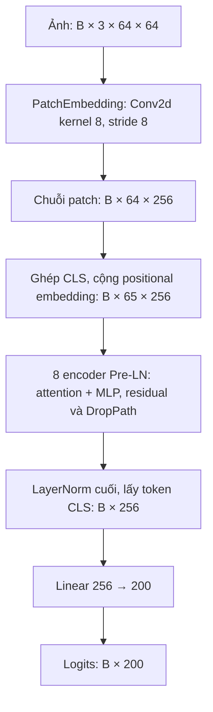

# Báo cáo: Phân loại ảnh Tiny ImageNet bằng Vision Transformer

> **Bản nháp, cập nhật ngày 2026-11-17.** Bản này bổ sung phần ViT của TV2 theo TASK-004 và phương án trực quan hóa attention. Các phần còn thiếu được ghi rõ để nhóm tiếp tục ghép báo cáo theo mục 15 của [spec](../SPEC_ViT.md). TASK-004 đang chờ TV1 review tại [PR #2](https://github.com/QuocAn118/Classify-images-using-Vision-Transformer/pull/2); chưa có kết quả huấn luyện hoặc đánh giá trên dữ liệu thật.

## 1. Vấn đề và phạm vi

Chưa hoàn thiện. TV1 bổ sung bài toán, động cơ so sánh ViT với CNN cùng số tham số và phạm vi đồ án theo [docs/01_define.md](../docs/01_define.md).

## 2. Dữ liệu

Chưa hoàn thiện. TV1 bổ sung nguồn, cách chia tập, thống kê và ảnh mẫu theo [docs/04_data.md](../docs/04_data.md). File thống kê đã có tại [dataset_stats.json](../outputs/results/dataset_stats.json); chưa kiểm tra lại dữ liệu thật trong buổi viết phần báo cáo này.

## 3. Phương pháp

### 3.1. Kiến trúc ViT (TV2)

Vision Transformer biểu diễn ảnh thành một chuỗi patch và dùng Transformer để xử lý quan hệ giữa các patch. Ý tưởng chia ảnh thành token và sử dụng token phân loại được tham khảo từ [Dosovitskiy và cộng sự](https://arxiv.org/abs/2010.11929). Trong đồ án, nhóm tự cài mô hình bằng PyTorch, không sử dụng ViT dựng sẵn hoặc trọng số pretrained.

Biến thể dùng trong repo có tên cấu hình `vit_small`. Các kích thước và siêu tham số dưới đây được lấy từ [vit_small.yaml](../configs/vit_small.yaml); đây là cấu hình riêng của đồ án.

| Thuộc tính | Giá trị |
|---|---|
| Ảnh đầu vào | RGB, 64 × 64 |
| Patch | 8 × 8, không chồng lấn |
| Số patch / tổng số token có CLS | 64 / 65 |
| Chiều embedding | 256 |
| Số encoder block | 8 |
| Số attention head mỗi block | 8 |
| MLP ratio | 4 |
| Dropout | 0,0 |
| DropPath lớn nhất | 0,1 |
| Số lớp đầu ra | 200 |
| Số tham số đã đếm bằng code | 6.436.296 |

Số tham số và shape forward mặc định đã được kiểm tra, lưu tại [task004_vit_checks.json](../outputs/results/task004_vit_checks.json). Mã nguồn mô hình nằm trong [vit.py](../src/models/vit.py).



**Patch embedding và vị trí.** Với ảnh vuông cạnh $H$ và patch cạnh $P$, số patch là $N=(H/P)^2$. `PatchEmbedding` dùng Conv2d có kernel và stride bằng $P$, sau đó trải phẳng hai chiều không gian thành chuỗi. Một CLS token học được được ghép ở đầu chuỗi để tổng hợp thông tin phục vụ phân loại. Positional embedding học được có shape `(1,N+1,D)` được cộng vào chuỗi để biểu diễn vị trí của từng token. Trong cấu hình mặc định, chuỗi sau bước này có shape `(B,65,256)`.

**Encoder Pre-LN.** Mỗi block áp LayerNorm trước attention và trước MLP, với hai kết nối residual:

$$
U_l = Z_{l-1} + \operatorname{DropPath}_l\bigl(\operatorname{MSA}(\operatorname{LN}_1(Z_{l-1}))\bigr),
$$

$$
Z_l = U_l + \operatorname{DropPath}_l\bigl(\operatorname{MLP}(\operatorname{LN}_2(U_l))\bigr).
$$

MSA là multi-head self-attention. MLP gồm Linear mở rộng chiều embedding theo `mlp_ratio`, GELU, dropout, Linear đưa về chiều ban đầu và dropout. `DropPath` bỏ toàn bộ nhánh residual theo từng ảnh khi train, đồng thời chia cho xác suất giữ nhánh để bảo toàn kỳ vọng. Xác suất bỏ nhánh tăng tuyến tính theo độ sâu, từ 0 đến 0,1 ở cấu hình mặc định. Khi `eval()`, DropPath và dropout đều tắt.

**Hai nhánh attention.** Từ embedding của mỗi token, một Linear chung tạo $Q$, $K$, $V$, rồi chia thành các head. Với chiều mỗi head là $d_h$:

$$
A = \operatorname{softmax}\left(\frac{QK^T}{\sqrt{d_h}}\right),
\qquad O = \operatorname{Dropout}(A)V.
$$

Nhánh forward thường dùng `torch.nn.functional.scaled_dot_product_attention` để tính attention; khi eval, xác suất dropout được truyền tường minh là 0. Nhánh `return_attn=True` tính công thức trên trực tiếp, dùng chung trọng số qkv/proj và trả thêm $A$ **trước dropout**. Mỗi layer trả một tensor `(B,heads,N+1,N+1)`. Nhánh này cung cấp đầu vào cho phần trực quan hóa; bản thân việc trả weights chưa tạo ra hình attention hoặc chứng minh chất lượng dự đoán.

**Head và khởi tạo.** Sau encoder cuối, LayerNorm được áp lên chuỗi, lấy biểu diễn CLS và đưa qua Linear để tạo logits. Mô hình không softmax logits, để bên huấn luyện có thể dùng CrossEntropyLoss. Trọng số Linear, CLS token và positional embedding được khởi tạo bằng truncated normal với độ lệch chuẩn 0,02; bias Linear bằng 0, LayerNorm có weight bằng 1 và bias bằng 0. Đây là các giá trị khởi tạo trong code, không phải kết quả huấn luyện.

**Tích hợp.** Các thành phần khác tạo mô hình qua `build_model(cfg)` trong [src/models/__init__.py](../src/models/__init__.py). Hàm lấy `img_size`, `num_classes` từ phần `data` và các thuộc tính kiến trúc từ phần `model`, không sửa config của bên gọi. Mô hình báo lỗi nếu kích thước ảnh không chia hết cho patch, chiều embedding không chia hết cho số head hoặc input không đúng shape RGB đã cấu hình. Hợp đồng chi tiết được giữ tại [docs/05_model.md](../docs/05_model.md).

### 3.2. Baseline CNN và khớp số tham số (TV3)

Chưa có. TV3 bổ sung kiến trúc CNN, cách tìm cấu hình và số tham số thực tế sau TASK-005. Hiện chưa xác minh điều kiện chênh số tham số không quá 5%; không suy ra điều kiện này chỉ từ số tham số ViT.

### 3.3. Công thức huấn luyện và augmentation

Chưa hoàn thiện. Cấu hình dự kiến và hợp đồng huấn luyện ở [docs/06_training.md](../docs/06_training.md); pipeline dữ liệu ở [docs/04_data.md](../docs/04_data.md). TV4 bổ sung cách triển khai và cấu hình thực tế sau khi có vòng lặp train; hiện chưa có lần huấn luyện hoàn chỉnh.

## 4. Thực nghiệm

### 4.1. Kiểm chứng cài đặt ViT đã thực hiện

Đây là kiểm chứng chức năng mô hình bằng dữ liệu giả, không phải thí nghiệm đo accuracy trên Tiny ImageNet. Kết quả sau lấy từ [task004_vit_checks.json](../outputs/results/task004_vit_checks.json), chạy ngày 2026-11-17 trên CPU với Python 3.12.10 và torch 2.15.0+cpu, seed 42.

| Kiểm tra | Kết quả đã lưu |
|---|---|
| Input / logits | `(2,3,64,64)` → `(2,200)` |
| Attention | 8 layer, mỗi tensor `(2,8,65,65)` |
| Số tham số | 6.436.296 |
| Sai khác logits lớn nhất giữa hai nhánh ở eval | Khoảng 7,15 × 10⁻⁷, dưới ngưỡng 10⁻⁴ |
| Sai số lớn nhất của tổng hàng attention so với 1 | Khoảng 2,38 × 10⁻⁷, dưới ngưỡng 10⁻⁴ |
| Backward | Gradient của mọi tham số hữu hạn |
| Một bước AdamW trên batch giả | Trọng số head thay đổi |

Theo bằng chứng trong [nhật ký TASK-004](../docs/10_work_log.md), lệnh `python -m pytest tests/test_models.py -q -W error` đạt **23 test mô hình**, và `python -m pytest -q -W error` đạt **48 test toàn repo**. Bộ [test_models.py](../tests/test_models.py) bao phủ shape mặc định, attention, cấu hình lưới patch khác, input/config lỗi, train/eval của dropout và DropPath, backward qua cả hai nhánh và nạp state dict bằng `weights_only=True`. Các kiểm tra này đã chạy trong buổi triển khai; buổi viết báo cáo không chạy lại unit test vì code không đổi.

Những bằng chứng trên xác nhận mô hình có thể forward, truyền gradient và cập nhật tham số trong các trường hợp đã thử. Chúng chưa chứng minh mô hình học tốt hoặc đáp ứng giới hạn VRAM của máy train.

### 4.2. Huấn luyện, đường cong học và ablation

Chưa có. TV4 bổ sung cấu hình chạy thật, log, đường cong học và các thí nghiệm đã hoàn thành. Top-1, Top-5, thời gian mỗi epoch, tốc độ inference và VRAM đỉnh hiện **chưa có**; không sử dụng kết quả trên batch giả để điền các chỉ số này.

## 5. So sánh ViT với CNN

Chưa có. TV5 tổng hợp sau khi có kết quả của hai mô hình. Chưa có cơ sở kết luận ViT tốt hơn hoặc kém hơn CNN. Khi bổ sung, bảng phải dẫn về file kết quả thực tế và nêu rõ cùng số tham số không đồng nghĩa cùng chi phí tính toán; FLOPs/MACs chưa đo thì ghi "chưa có".

## 6. Trực quan hóa attention (TV2)

### 6.1. Phần đã có

ViT đã hỗ trợ `return_attn=True` để trả attention theo từng head và layer, trước dropout. Ở cấu hình mặc định, danh sách có 8 tensor `(B,8,65,65)`, trong đó token đầu tiên là CLS. Shape, tổng hàng và độ khớp logits giữa hai nhánh đã được kiểm tra như mục 4.1.

### 6.2. Phương án dự kiến cho TASK-008

Phần dưới mô tả phương án đã thống nhất trong [docs/07_evaluation.md](../docs/07_evaluation.md) và spec; chưa có code sinh hình hoặc checkpoint đã huấn luyện để chạy phương án này.

**CLS attention map:** lấy hàng CLS tới các patch ở layer cuối, bỏ cột CLS, trung bình theo head rồi reshape thành lưới `img_size // patch_size`. Sau đó nội suy bilinear lên kích thước ảnh và phủ heatmap lên ảnh gốc. Với cấu hình mặc định, lưới patch là 8 × 8.

**Attention rollout:** kết hợp attention qua các layer theo phương pháp của [Abnar và Zuidema (2020)](https://aclanthology.org/2020.acl-main.385/). Với $A_l$ là attention trung bình theo head của layer $l$, phương án của đồ án bổ sung residual và chuẩn hóa theo hàng:

$$
\widetilde A_l = \operatorname{RowNorm}(0.5 A_l + 0.5 I),
\qquad R_0 = I,\quad R_l = \widetilde A_l R_{l-1}.
$$

Hàng CLS của $R_L$, bỏ cột CLS, được đưa về lưới patch để tạo heatmap. Kế hoạch trình bày gồm ít nhất 12 ảnh từ nhiều lớp, có cả dự đoán đúng và sai; mỗi ảnh đặt cạnh CLS map layer cuối và rollout. Chỉ thực hiện trên checkpoint đã chốt, không dùng tập test để chọn cấu hình hoặc checkpoint.

### 6.3. Hình và nhận xét thực tế

| Nội dung | Trạng thái |
|---|---|
| Trả attention từ ViT | Đã cài và kiểm tra trên dữ liệu giả |
| Code sinh CLS map / rollout | Chưa có, thuộc TASK-008 |
| Hình cho ít nhất 12 ảnh | Chưa có |
| So sánh ảnh dự đoán đúng và sai | Chưa có |
| Nhận xét vùng được chú ý trên ảnh thật | Chưa có |

Phần này sẽ được cập nhật sau khi có pipeline huấn luyện và checkpoint. Khi phân tích, heatmap được dùng để khảo sát phân bố attention; không coi riêng heatmap là bằng chứng quan hệ nhân quả của quyết định phân loại. Bài [Abnar và Zuidema](https://aclanthology.org/2020.acl-main.385/) cũng phân tích hạn chế của việc dùng attention thô để giải thích khi thông tin đã trộn qua nhiều layer.

## 7. Phân tích lỗi và giới hạn

Giới hạn hiện có của phần ViT: kiểm chứng mới dùng dữ liệu giả trên CPU; chưa đo CUDA, AMP, VRAM, tốc độ hoặc chất lượng phân loại. Chưa có checkpoint huấn luyện để phân tích overfit, lớp hay nhầm hoặc attention trên ảnh thật. Các test truyền gradient và khớp hai nhánh không thay thế đánh giá trên dữ liệu thật.

TV5 và các thành viên bổ sung phân tích lỗi, giới hạn ngân sách huấn luyện và độ tin cậy của kết quả sau khi hoàn thành thí nghiệm. Không kết luận ưu thế giữa hai mô hình khi chưa có số liệu.

## 8. Hướng dẫn cài đặt, chạy và demo

Chưa hoàn thiện phần bàn giao cuối. Hướng dẫn đang chạy được nằm ở [README](../README.md), gồm cài môi trường, chuẩn bị dữ liệu và kiểm thử. Có thể chạy riêng test ViT mà không tải bộ dữ liệu:

```bash
python -m pytest tests/test_models.py -q -W error
```

TV1 và TV5 bổ sung lệnh train, đánh giá, demo và link checkpoint sau khi đã chạy thành công; hiện chưa có các sản phẩm đó.

## 9. Kết luận và hướng phát triển

Chưa có kết luận thực nghiệm ViT so với CNN. Kết quả hiện tại của TV2 là mô hình ViT tự cài, có giao diện lấy attention và các kiểm chứng chức năng nêu trên, đang chờ review. TV1 bổ sung kết luận chung sau khi có kết quả huấn luyện, đánh giá và trực quan hóa.

## 10. Tài liệu tham khảo

1. Alexey Dosovitskiy và cộng sự (2020). [An Image is Worth 16x16 Words: Transformers for Image Recognition at Scale](https://arxiv.org/abs/2010.11929). arXiv:2010.11929. Cơ sở kiến trúc ViT; cấu hình trong đồ án được trình bày riêng tại mục 3.1.
2. Samira Abnar và Willem Zuidema (2020). [Quantifying Attention Flow in Transformers](https://aclanthology.org/2020.acl-main.385/). ACL, trang 4190–4197. Cơ sở phương án attention rollout tại mục 6.2.

Danh mục sẽ được nhóm bổ sung khi ghép các phần CNN, dữ liệu, huấn luyện và phân tích kết quả.
